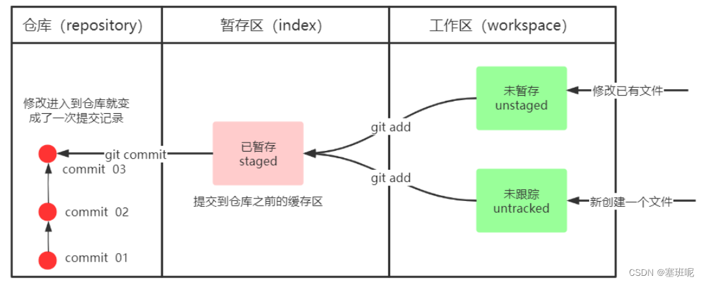
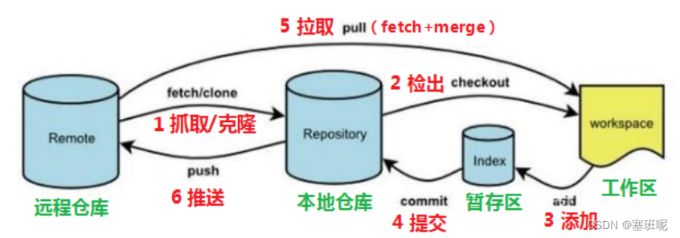

# Git 学习笔记

---

# 0、五个核心问题

## 0.1 Git 是什么？为什么它能成为广泛使用的版本控制工具？

**Git 是什么**：装在你电脑上的一个**分布式版本控制系统**。它把项目每一次修改都记录下来，随时能回退、对比、合并。

**为什么广泛使用**（六条理由）：

1. **分布式**：每个人电脑里都有完整仓库（含全部历史）。服务器坏了随便找一台电脑就能恢复；断网也能提交、看历史、建分支。
2. **快**：Git 存的是"快照 + 指针"，绝大多数操作（add、commit、branch、merge）都在本地完成，不联网也能秒级完成。
3. **分支强大**：创建、切换分支就是挪动一个指针，几乎零成本。特别适合"一人一分支、一个功能一分支"的团队协作。
4. **数据安全**：每次提交都用 SHA-1 哈希校验，文件被偷偷改了能检测出来。
5. **免费开源**：2005 年 Linus Torvalds 为了管理 Linux 内核代码而写，本身免费，GitHub、GitLab、Gitee 等平台都基于它。
6. **生态好**：VS Code、IDEA 等主流工具深度集成；GitHub/Gitee 等平台提供协作、代码审查、持续集成一条龙。

## 0.2 为什么开发者需要版本控制？直接复制文件备份有什么局限？

直接复制文件夹（比如 `项目-最终版`、`项目-最终版2`、`项目-真的最终版`……）看起来能备份，其实有六个致命问题：

| 问题 | 直接复制的后果 | Git 怎么解决 |
|------|----------------|--------------|
| 不知道改了什么 | 两个文件夹放一起，看不出到底哪行变了 | `git diff` 精确显示每一行的增删 |
| 不知道谁改的、什么时候改的 | 文件本身不带作者和时间记录 | `git log` / `git blame` 查到人和时间 |
| 回退困难 | 只能手动找旧文件夹覆盖，容易覆盖错 | `git reset` / `git revert` 一键回退 |
| 多人协作会互相覆盖 | A 和 B 同时改，只能留一个版本，另一个白干 | 分支 + 合并 + 冲突解决，两边改动都能保留 |
| 空间浪费 | 每个版本存一整份，项目大了很占空间 | 只存变化的部分（快照机制），省空间 |
| 容易混乱 | 文件名越堆越多，"最终版"能有八个 | 一个仓库搞定，所有版本整整齐齐 |

## 0.3 Git、GitHub 和 Gitee 分别是什么？它们之间有什么区别？

| 对比 | Git | GitHub | Gitee |
|------|-----|--------|-------|
| 是什么 | 版本控制**工具/软件**（本地命令） | 基于 Git 的代码托管**网站**（国外） | 基于 Git 的代码托管**网站**（国内，也叫"码云"） |
| 装在哪 | 你的电脑上 | 微软的服务器上 | 开源中国的服务器上 |
| 必须联网吗 | 不用，本地就能用 | 要 | 要 |
| 主要作用 | 记录版本、分支管理、diff、回退 | 备份、分享、开源协作（PR、Issue） | 同 GitHub，且国内访问速度快 |
| 代表地址 | 没有网址，是命令 | github.com | gitee.com |

**GitHub 和 Gitee 怎么选**：

- **GitHub**：全球最大的开源社区，找国外项目、给国外项目提 PR 都用它；缺点是国内访问有时慢或不稳定。
- **Gitee（码云）**：国内平台，访问快、全中文，适合国内团队和课程作业；很多学校、国内公司都用。

## 0.4 什么是仓库、提交、分支和合并？

| 概念 | 英文 | 大白话解释 |
|------|------|-----------|
| 仓库 | Repository / repo | 一个被 Git 管理的文件夹，里面有 `.git` 隐藏目录存所有历史。相当于"项目档案室" |
| 提交 | Commit | 把一批改动打包成一个版本存档，有唯一编号（commit id）和说明。相当于"拍一张项目快照" |
| 分支 | Branch | 从某个提交拉出的一条独立的开发线，各改各的互不干扰。相当于"平行宇宙" |
| 合并 | Merge | 把一条分支上的改动并入另一条分支。相当于"把平行宇宙的成果汇总" |

四者连起来的流程：

```text
git init（建仓库）
  → 改代码 → git add → git commit（产生一个提交，形成历史线）
  → 要并行开发 → git checkout -b 新分支（分叉）
  → 各自提交
  → 完成后切回主分支 → git merge 分支名（合并）
```

**三个关键理解**：

- 提交不是"保存文件"，而是"保存整个项目在这个时刻的状态（快照）"。
- 分支不是"复制一份代码"，而是一个指向某次提交的**指针**，所以创建和切换都很快。
- 合并时如果两条分支改了同一行，Git 无法自动决定，就产生**冲突**，需要人工解决（见 3.6 节）。

## 0.5 团队协作中，如何用 Git 管理和同步项目文件？

**总体套路：远程仓库 + 分支开发 + Pull Request。**

1. **建远程仓库**：一个人在 GitHub / Gitee 上建仓库，把其他人加为协作者（Collaborator）。
2. **各自克隆**：每人 `git clone 仓库地址` 到本地，得到完整仓库。
3. **配置身份**：每人设置自己的 `user.name` 和 `user.email`（见 2.1.3 节）。
4. **开分支干活**：不要直接在 main 上改，每人从最新的 main 创建自己的分支：

   ```bash
   git checkout main
   git pull                     # 先同步别人的最新改动
   git checkout -b feature-xxx  # 建自己的分支
   ```

5. **提交推送**：在分支上改完 → `git add` → `git commit` → `git push origin feature-xxx`。
6. **提 PR**：在 GitHub / Gitee 网页上创建 Pull Request，请求把你的分支合并进 main。
7. **审核合并**：别人审查代码、讨论，确认没问题后合并；合并完可以删掉这个分支。
8. **保持同步**：每天开工前先 `git pull`；main 有更新时及时合并或变基到自己的分支，减少冲突。

**核心规则**：

- **先 pull 再改**，改完尽快 commit、push，别攒一大堆。
- **不在 main 上直接开发**，一人一分支。
- **提交信息写清楚**，别写 `aaa`、`update`。
- **多人协作的分支禁用 reset 和强推**，撤销用 revert。
- **冲突先沟通**，别擅自删别人的代码。
- **密钥文件（.env）和依赖包（node_modules）不要提交**，用 `.gitignore` 挡掉。

---

# 一、Git 基础概念

## 1.1 Git 是什么

Git 是一个**分布式版本控制系统**（Distributed Version Control System，简称 DVCS）。

拆开理解：

- **版本控制**：帮你记录文件的每一次修改，随时能回到过去的任一版本。像游戏存档。
- **分布式**：每个人电脑上都有完整的代码仓库副本，不像 SVN 那样只有服务器上有完整版本。断网也能提交、看历史。

Git 的作用：

- 改崩了想回到昨天那个能跑的版本 → `git reset` / `git revert`
- 不知道谁在什么时候改了哪一行 → `git log` / `git blame`
- 两个人同时改一个文件 → 分支 + 冲突解决
- 代码备份 → push 到远程仓库

## 1.2 三个工作区域（最重要）



| 区域 | 英文 | 解释 |
|------|------|----------|
| 工作区 | Working Directory | 你平时写代码、能直接看到的那个文件夹 |
| 暂存区 | Stage / Index | 一个"待提交清单"，放你准备打包的文件 |
| 本地仓库 | Repository | 隐藏的 `.git` 文件夹，存所有历史版本 |
| 远程仓库 | Remote | GitHub 上那个云端的仓库 |

现在的工具（比如 VS Code）淡化了暂存区的概念——点一次 Commit 按钮，其实同时做了 add 和 commit。

用 `git status` 随时看当前状态：

```bash
git status
```

## 1.3 Git 的工作流程图



---

# 二、本地仓库操作

### 2.1.3 配置用户名和邮箱

Git 每次提交都要记录"谁提交的"，所以要告诉它你是谁：

```bash
git config --global user.name "你的用户名"
git config --global user.email "你的邮箱@example.com"
```

**验证配置**：

```bash
git config --list
```

**踩坑**：

- 邮箱写错不影响本地提交，但 push 到 GitHub 后贡献记录可能对不上。建议写 GitHub 注册邮箱。
- 忘记加 `--global` 的话，配置只对当前仓库生效，换个仓库又要重新配。
- 中文用户名在某些场景可能乱码，建议用拼音或英文。

### 2.1.4 其他常用配置

```bash
git config --global core.editor "code --wait"   # 把 VS Code 设为默认编辑器
git config --global init.defaultBranch main     # 新建仓库默认分支名改成 main
git config --global color.ui true               # 打开彩色输出
```

### 2.1.5 配置级别说明

| 级别 | 参数 | 作用范围 | 配置文件位置 |
|------|------|----------|--------------|
| 系统级 | `--system` | 这台电脑所有用户 | `/etc/gitconfig` |
| 全局级 | `--global` | 当前用户所有仓库 | `~/.gitconfig`（Windows 是 `C:\Users\你的用户名\.gitconfig`） |
| 仓库级 | `--local`（默认） | 当前仓库 | `.git/config` |

优先级：仓库级 > 全局级 > 系统级。

## 2.2 获取本地仓库

有两种方式拿到本地仓库。

### 2.2.1 方式一：把普通文件夹变成仓库（init）

```bash
mkdir my-git-demo
cd my-git-demo
git init
```

**成功标志**：输出 `Initialized empty Git repository in C:/.../my-git-demo/.git/`，并且文件夹里多了一个隐藏的 `.git` 目录。

看隐藏文件的方法：

```bash
ls -a          # Git Bash / Linux
dir /a         # Windows CMD
```

**踩坑**：

- 看不到 `.git` 是正常的，它是隐藏文件夹，别删它！删了就不是仓库了。
- 不要在用户主目录（`C:\Users\你的用户名`）直接 `git init`，会把整个主目录变成仓库，很乱。

### 2.2.2 方式二：把远程仓库克隆下来（clone）

```bash
git clone 仓库地址
```

举例：

```bash
git clone https://github.com/你的用户名/test.git
```

## 2.3 Git 常用指令 ★

### 2.3.1 git status —— 看当前状态

```bash
git status
```

作用：告诉你哪些文件改了、哪些在暂存区、哪些没被跟踪。

简版输出（更常用）：

```bash
git status -s
```

```text
M  hello.txt   # 已暂存的修改（M 在第一列）
 M test.txt   # 未暂存的修改（M 在第二列）
?? new.txt    # 未跟踪的新文件
```

状态符号含义：

| 符号 | 含义 |
|------|------|
| `??` | 未跟踪，Git 从没见过这个文件 |
| `A` | 新添加到暂存区 |
| `M` | 修改过 |
| `D` | 删除了 |
| 第一列 | 暂存区的状态 |
| 第二列 | 工作区的状态 |

### 2.3.2 git add —— 放进暂存区

```bash
git add 文件名              # 添加单个文件
git add *.txt               # 添加所有 txt 文件
git add .                   # 添加当前目录下所有改动（最常用）
git add -A                  # 添加整个仓库所有改动
git add -u                  # 只添加已跟踪文件的改动，不含新文件
```

**成功标志**：`git status` 里 `hello.txt` 出现在 `Changes to be committed` 下面，状态符号变成 `A`。

**踩坑**：

- `git add .` 只会处理当前目录及其子目录。在子目录里执行时，别以为加了整个仓库，要用 `git add -A`。
- add 之后又改了文件，需要**再 add 一次**，否则提交的是 add 那一刻的版本。

### 2.3.3 git commit —— 提交到本地仓库

```bash
git commit -m "本次提交说明"
```

**常用变体**：

```bash
git commit -am "修改说明"     # add + commit 二合一，但只对已跟踪文件有效，新文件不行
git commit --amend            # 修改上一次提交（改信息或补文件）
git commit --allow-empty -m "test"  # 空提交，测试用
```

**踩坑**：

- 忘记 `-m` 会打开 vim 编辑器。解决办法：按 `i` 进入编辑模式，输入说明，按 `Esc`，再输入 `:wq` 回车保存退出。
- 什么都没 add 就 commit，会提示 `nothing to commit`。

**关于 commit，再记住三点：**

**① commit 是版本控制的基本单位。** 每一次 commit，Git 都保存当前仓库的一个快照。commit 越来越多，就形成一条可回溯的历史链路。

**② commit id 有两种形式。** 完整 hash 和短 ID（一般取前 7 位）。跟 AI 沟通时直接给 commit id 最准确，比如"把仓库回退到 commit abc1234 的状态"，比说"回到上一个版本"靠谱得多。

**③ 让 AI 干活时，做完一个小功能就 commit 一次。** 比如让 AI 做完登录页面 → 测试 → commit → 再做注册页面 → 测试 → commit。好处是 AI 改错了能快速撤销，历史也清晰。

### 2.3.4 git log —— 查看提交历史

```bash
git log                      # 完整历史
git log --oneline            # 每条提交压成一行（最常用）
git log -n 3                 # 只看最近 3 条
git log --graph              # 图形化显示分支合并历史
git log --all --graph --oneline  # 终极版，看全部分支
```

`HEAD` 是一个指针，指向你当前所在的提交。

**踩坑**：`git log` 输出太多时会进入一个分页器（less），按 `q` 退出，按空格翻页。

### 2.3.5 git reset —— 版本回退

**回退到上一个版本**：

```bash
git reset --hard HEAD^
```

- `HEAD` 是当前版本
- `HEAD^` 是上一个版本
- `HEAD^^` 是上上个版本
- `HEAD~100` 是往前 100 个版本

**回退到指定版本**：

```bash
git reset --hard 3f2a1b9
```

commit id 不用写全，前 6–7 位能唯一识别就行。

**三种模式的区别**：

| 模式 | 本地仓库 | 暂存区 | 工作区 | 用在哪 |
|------|----------|--------|--------|--------|
| `--soft` | 回退 | 不变 | 不变 | 想重新 commit，但保留所有改动 |
| `--mixed`（默认） | 回退 | 清空 | 不变 | 想把 add 的东西撤回来 |
| `--hard` | 回退 | 清空 | 清空 | 彻底回到某个版本，改动全丢 |

**危险提示**：`--hard` 会**丢掉工作区没提交的所有改动**，且找不回来（除非用过 reflog）。执行前先 `git status` 确认没有想保留的改动。

**多人协作时别用 reset**，用 revert。

### 2.3.6 git reflog —— 找回"丢失"的版本

```bash
git reflog
```

作用：记录 HEAD 的每一次移动，包括被 reset 掉的版本。

典型输出：

```text
3f2a1b9 HEAD@{0}: reset: moving to HEAD^
a1b2c3d HEAD@{1}: commit: 完整功能版
3f2a1b9 HEAD@{2}: commit: add hello.txt
```

如果不小心 `--hard` 回退错了，用 reflog 找到那个 commit id 再 reset 回去：

```bash
git reset --hard a1b2c3d
```

### 2.3.7 撤销工作区的修改

```bash
git checkout -- 文件名
```

新版写法：

```bash
git restore 文件名
```

作用：把工作区里改坏的文件恢复成暂存区（或仓库）里的样子。

**踩坑**：这个命令也是**不可恢复**的，改乱的内容会直接被覆盖。

### 2.3.8 撤销暂存区的修改

```bash
git reset HEAD 文件名
```

新版写法：

```bash
git restore --staged 文件名
```

作用：把文件从暂存区移出来，但保留工作区的改动。用于"add 错了，想重新 add"。

### 2.3.9 git diff —— 比较差异

```bash
git diff                 # 工作区 vs 暂存区
git diff --cached        # 暂存区 vs 本地仓库
git diff HEAD            # 工作区 vs 本地仓库
git diff 版本A 版本B      # 比较两个版本
git diff 版本A 版本B -- 文件名  # 只比较某个文件
```

输出里 `+` 开头是新增的行，`-` 开头是删除的行。

### 2.3.10 git rm —— 删除文件

```bash
git rm 文件名
git commit -m "删除某文件"
```

只在工作区删（`rm 文件名`）但没 `git rm` 的话，`git status` 会显示 `D` 状态，需要 `git add -u` 或 `git rm` 来记录这次删除。

### 2.3.11 忽略文件 .gitignore

在项目根目录建一个 `.gitignore` 文件，写要忽略的东西：

```text
# 这是注释
*.class
*.log
target/
.idea/
node_modules/
.env
.DS_Store
```

**成功标志**：`git status` 里不再显示这些文件。

特别提醒两个**绝对不能提交**的东西：

- `.env` —— 里面可能有 API Key、数据库密码、Token
- `node_modules/` —— 依赖包能用 `npm install` 重装，没必要传

**踩坑**：如果文件已经被 add 过了，改 `.gitignore` 不会生效，要先从暂存区移除：

```bash
git rm -r --cached .
git add .
git commit -m "更新 gitignore"
```

## 2.4 discard / reset / revert

| 操作 | 行为 | 适用场景 | 风险 |
|------|------|----------|------|
| discard | 放弃还没 Commit 的改动 | 文件改了但还没提交，想撤销 | 改动会丢 |
| reset | 强制回退到某个历史 commit | 单人分支，或改动还没推到远程 | 可能删除历史 |
| revert | 生成一个反向提交来撤销某次 commit | 多人协作分支 | 更安全 |

**核心原则：多人协作的分支上禁止 reset，优先用 revert。** 因为 reset 会改写历史，别人已经拉下去的代码会对不上；revert 只是加一条新提交，不改变已有历史。

```bash
git revert <commit-id>      # 撤销某次提交，但保留历史
```

让 AI 帮你做时可以这么说：

```text
请撤销 commit abc1234 的改动，但保留其他提交不变。
优先使用 revert，而不是 reset。
```

---

# 三、分支管理

## 3.1 分支是什么

```text
没有分支：
A → B → C → D → E   （所有人都在一条线上改）

有分支：
        ┌→ C → D    （dev 分支，开发新功能）
A → B ──┤
        └→ E → F    （main 分支，稳定版本）
```

- **主分支（main / master）**：放稳定、能上线的代码。
- **开发分支（dev）**：日常开发用。
- **功能分支（feature-xxx）**：做某个具体功能用，做完合并回主分支。

分支本质上是**指针**，不是拷贝代码。所以创建分支几乎不花时间，切换也很快。新分支刚创建时，代码跟来源分支一模一样；你在分支上的改动和 Commit 只对该分支生效，不影响主干。

## 3.2 分支命令全解

**查看分支**：

```bash
git branch           # 列出本地分支，当前分支前有 *
git branch -v        # 显示每个分支最后的提交
git branch -a        # 查看所有分支，包括远程分支
```

输出：

```text
* master
  dev
```

**创建分支**：

```bash
git branch 分支名
```

git branch 查看能看到新分支。

**切换分支**：

```bash
git checkout 分支名
```

新版写法：

```bash
git switch 分支名
```

**成功标志**：提示 `Switched to branch 'dev'`。

**踩坑**：切换分支前先把当前分支的改动提交或 stash，否则可能切换失败或把改动带过去。

**创建并切换**：

```bash
git checkout -b 分支名
```

新版写法：

```bash
git switch -c 分支名
```

等价于 `git branch 分支名` + `git checkout 分支名`。

**合并分支**：

```bash
git merge 要合并进来的分支名
```

比如你在 main 上，想把 dev 的工作合并过来：

```bash
git checkout main
git merge dev
```

**删除分支**：

```bash
git branch -d 分支名      # 安全删除，未合并的分支不给删
git branch -D 分支名      # 强制删除，未合并也能删
```

注意：Git 不允许删除当前所在的分支，要先切到别的分支再删。

**分支命名习惯**：

| 分支名 | 用途 |
|--------|------|
| `main` / `master` | 主分支，稳定版 |
| `dev` | 开发主分支 |
| `feature/login` | 功能分支 |
| `fix/header-bug` | 修 bug |
| `hotfix/security-patch` | 紧急修复 |

## 3.3 HEAD 与分离头指针

**HEAD ：当前仓库处于哪一次 Commit 上。**

- 在 main 分支上，HEAD 指向 main 的最新 commit
- 在 feature 分支上，HEAD 指向 feature 的最新 commit
- 如果 checkout 到某个历史 commit，但不指向任何分支，就是**分离头指针（detached HEAD）**状态

```bash
git checkout a1b2c3d     # 进入 detached HEAD 状态
```

**detached HEAD 状态下不要写代码**，因为你不在任何分支上，提交的改动很容易丢失。

如果真要基于历史版本改东西，正确做法是基于那个 commit **新建分支**：

```bash
git switch -c fix-from-old a1b2c3d
```

## 3.4 git stash —— 临时存起改动

场景：你正在 dev 上改东西，突然要切到 main 修 bug，但改动还没写完不想提交。

```bash
git stash           # 把当前改动收起来
git stash list      # 看暂存列表
git stash pop       # 恢复最近的暂存
git stash apply     # 恢复但不清列表
git stash drop      # 删除某条暂存
```

**注意**：stash 和暂存区（staging area）不是一回事。stash 是把改动整个收起来，工作区变干净；暂存区是准备下次提交的内容。

让 AI 帮你做：

```text
我现在代码写到一半。
请把当前未提交修改 stash 起来，然后切换到 main 分支。

（回来后）
请切回 feature 分支，并把刚才 stash 的修改 pop 回来。
```

## 3.5 worktree —— 多个分支并行开发

**worktree 是什么**：给同一个 Git 仓库创建多个工作文件夹，让不同分支在不同文件夹里同时工作。

```text
项目主文件夹/          ← main 分支
项目-feature-login/    ← feature/login 分支
项目-fix-bug/          ← fix/bug 分支
```

每个 worktree 对应一个分支，是一个独立文件夹，互不干扰。

**适合场景**：

- 多个 AI Agent 并行开发（各占一个 worktree）
- 一边修 bug，一边做新功能
- 不想频繁切换分支
- 把不同实验隔离开

让 AI 帮你做：

```text
创建一个新的 worktree 和分支，用来开发登录功能。
完成后提交，并合并回 main。
```

## 3.6 解决冲突

### 3.6.1 冲突是怎么产生的

两个分支**改了同一个文件的同一行**，Git 不知道听谁的，就报冲突。

```text
main 上：  "欢迎使用我们的网站"
dev 上：   "欢迎访问我们的官网"
```

### 3.6.2 冲突长什么样

执行 `git merge` 后提示：

```text
Auto-merging index.html
CONFLICT (content): Merge conflict in index.html
Automatic merge failed; fix conflicts and then commit the result.
```

打开文件会看到：

```html
<<<<<<< HEAD
欢迎使用我们的网站
=======
欢迎访问我们的官网
>>>>>>> dev
```

- `<<<<<<< HEAD` 到 `=======`：当前分支（你合并到的那个分支）的内容
- `=======` 到 `>>>>>>> dev`：被合并分支的内容

### 3.6.3 解决冲突的步骤（四步）

**第 1 步**：打开冲突文件，删掉 `<<<<<<<`、`=======`、`>>>>>>>` 这些标记，保留你想要的内容。

**第 2 步**：添加到暂存区

```bash
git add index.html
```

**第 3 步**：提交

```bash
git commit -m "解决与dev分支的冲突"
```

注意：这里**不要带文件名**，直接 `git commit` 就行。

**第 4 步**：确认状态干净

```bash
git status
```

显示 `nothing to commit, working tree clean` 就完事了。

**踩坑**：

- 光改了文件没 add 就 commit，Git 会提示还有未解决的冲突。
- 解决冲突时别把别人的改动整个删掉，先跟对应的人确认。
- `<<<<<<<` 标记没删干净就提交，代码会跑不起来。

### 3.6.4 让 AI 处理冲突

有 AI 时，它会给你选项，你选保留哪个（或两个都保留）。关键是**别让 AI 自己瞎决定**：

```text
合并这两个分支，如果出现冲突，请先停下来告诉我冲突文件和冲突内容。
不要自动决定，等我选择保留哪一版。
```

确定方案后：

```text
解决当前 merge conflict。
同一行冲突中，两个版本都保留，顺序是西瓜在前，草莓在后。
```

### 3.6.5 图形化工具

```bash
git mergetool
```

可以调用外部工具（如 VS Code）可视化解决冲突。IDEA 里的冲突解决更直观，见第五章。

## 3.7 分支使用流程

实际开发中的标准流程：

```text
1. 从 main 切出新分支
   git checkout -b feature-login main

2. 在新分支上开发、提交
   git add .
   git commit -m "完成登录功能"

3. 开发完切回 main，拉取最新代码
   git checkout main
   git pull

4. 合并你的分支
   git merge feature-login

5. 有冲突就解决（见 3.6 节）

6. 推送到远程
   git push

7. 删除已合并的分支
   git branch -d feature-login
```

**核心原则**：

- main 永远保持可上线状态。
- 不在 main 上直接开发。
- 每个功能一个分支，做完就合并删除。

## 3.8 强制删除分支的场景

正常情况下：

```bash
git branch -d 分支名
```

只能删除**已经合并过**的分支。如果分支上有没合并的提交，Git 会拒绝：

```text
error: The branch 'dev' is not fully merged.
If you are sure you want to delete it, run 'git branch -D dev'.
```

这时候如果你**确定不要这个分支了**：

```bash
git branch -D dev
```

**什么时候用 `-D`**：

- 这个分支是实验性质的，确定不要了。
- 分支上的代码已经用别的方式保存了。
- 分支做废了，想重来。

**警告**：`-D` 会丢掉未合并的提交，删之前想清楚。

## 3.9 分支相关命令小结

| 场景 | 命令 |
|------|------|
| 看分支 | `git branch` |
| 建分支 | `git branch 分支名` |
| 切分支 | `git checkout 分支名` |
| 建并切 | `git checkout -b 分支名` |
| 合并 | `git merge 分支名` |
| 删分支 | `git branch -d 分支名` |
| 临时存改动 | `git stash` |
| 恢复改动 | `git stash pop` |

## 3.10 合并的快进模式

### 3.10.1 什么是 Fast-forward

如果你在 main 上，dev 是基于 main 创建的，并且 main 期间没有新提交，那么合并 dev 时 Git 只需要把 main 指针直接往前挪到 dev 的位置，不需要创建新提交。这叫 **Fast-forward（快进）**。

```text
合并前：
A → B (main)
     └→ C → D (dev)

合并后（快进）：
A → B → C → D (main 和 dev 都指这里)
```

输出里会看到 `Fast-forward` 字样。

### 3.10.2 禁用快进模式

```bash
git merge --no-ff dev -m "合并dev分支"
```

这样 Git 会**强制创建一个新的合并提交**，即使能快进：

```text
A → B ────────→ M (main)
     └→ C → D ┘
```

**为什么要用 `--no-ff`**：

- 保留分支结构的历史，一眼能看出"这里发生过一次合并"。
- 方便以后回退整个功能：直接回退那个合并提交就行。

**实际建议**：小改动用默认快进就行，大功能合并用 `--no-ff` 保留记录。

### 3.10.3 合并冲突 vs 快进

- 能快进 → 不会冲突，指针直接挪。
- 不能快进且两边改了同一行 → 冲突，手动解决。

## 3.11 cherry-pick —— 只挑几个提交合并

**cherry-pick** ：从某个分支里只挑选指定的 commit，合并到当前分支。

### 使用场景

feature 分支上有 3 次提交：

1. 创建蔬菜清单
2. 创建肉类清单
3. 创建主食清单

现在你只想把 1 和 3 合并到 main，不想要 2，就用 cherry-pick。

```bash
git checkout main
git cherry-pick abc1234 def5678
```

让 AI 帮你做：

```text
请把这两个 commit cherry-pick 到 main 分支：
abc1234
def5678
不要合并其他 commit。
```

## 3.12 rebase —— 变基

**rebase 是什么**：把当前分支的基础，移动到另一个分支的最新位置上。

```text
feature 基于旧 main 创建，后来 main 有了新提交：

A → B → E (main)
     └→ C → D (feature)

rebase 后：

A → B → E → C' → D' (main + feature)
```

看起来就像 feature 是基于最新 main 开发的。

**好处**：历史记录更干净，不产生多余的 merge commit，commit 线更直。

**风险**：rebase 会**改写提交历史**。如果分支已经 push 到 GitHub，rebase 后通常要强推：

```bash
git push -f
```

**强制推送的危险**：可能覆盖别人的代码。

> **重要警告：rebase + force push 只适合你一个人使用的分支。多人协作分支禁止使用。**

### rebase 与 merge 对比

| 操作 | 特点 | 适合场景 |
|------|------|----------|
| merge | 保留分支合并历史，可能产生 merge commit | 团队协作、公共分支 |
| rebase | 历史更干净，但会改写历史 | 个人 feature 分支 |

让 AI 帮你做（一定先问风险）：

```text
请把当前 feature 分支 rebase 到最新 main 上。
操作前请说明是否需要 force push，以及这样做有什么风险。
```

---

# 四、远程仓库（GitHub）

## 4.1 Git 和 GitHub 不是一回事

| 对比 | Git | GitHub |
|------|-----|--------|
| 是什么 | 装在你电脑上的版本控制工具 | 托管 Git 仓库的网站 |
| 装在哪 | 本地 | 服务器上 |
| 断网能用吗 | 能，全部操作在本地 | 不能 |
| 作用 | 记录历史、分支管理 | 备份、分享、协作、开源 |

**GitHub = Git + Hub**：Git 仓库的集中托管平台。

**Gitee（码云）**：国内的代码托管平台，用法跟 GitHub 几乎一样，但访问速度快、全中文界面，适合国内团队和课程作业。三者对比见第零章 0.3 节。

仓库类型：

| 类型 | 含义 |
|------|------|
| Public Repository（公开仓库） | 所有人都能看到代码 |
| Private Repository（私有仓库） | 只有自己或被邀请的人能看到 |

**容易混的一点**：`git commit` 只是提交到**本地**，不等于上传 GitHub。要上传得 `git push`。

## 4.2 仓库托管：注册、创建仓库、配置 SSH Key

### 4.2.1 注册 GitHub

1. 打开 https://github.com
2. 点右上角 `Sign up`，填邮箱、用户名、密码
3. 去邮箱点验证链接激活

### 4.2.2 创建仓库

1. 登录后点右上角 `+` → `New repository`
2. 填仓库名称（比如 `git-test`）
3. 选 **Public** 或 **Private**（新手建议 Private）
4. **重要**：不要勾选 "Add a README file"、"Add .gitignore"、"Add a license"，否则本地 push 时会因为远程有本地没有的文件而冲突
5. 点 `Create repository`

**成功标志**：进入仓库页面，能看到提示的命令，类似：

```bash
git remote add origin https://github.com/你的用户名/git-test.git
git push -u origin main
```

### 4.2.3 配置 SSH Key（免密推送）

每次 push 都输用户名密码很烦，配了 SSH Key 就不用了。

**第 1 步：生成密钥对**

在 Git Bash 里敲：

```text
ssh-keygen -t ed25519 -C "你的邮箱@example.com"
```

**成功标志**：看到一段随机图案，最后提示公钥保存位置，类似：

```text
Your public key has been saved in /c/Users/你的用户名/.ssh/id_ed25519.pub
```

生成了两个文件：

- `id_ed25519`（或 `id_rsa`）：私钥，**千万不能给别人**
- `id_ed25519.pub`（或 `id_rsa.pub`）：公钥，要填到 GitHub 上

**第 2 步：复制公钥内容**

```bash
cat ~/.ssh/id_ed25519.pub
```

把输出的一整行（以 `ssh-ed25519` 或 `ssh-rsa` 开头）全选复制。

Windows 也可以用记事本打开 `C:\Users\你的用户名\.ssh\id_ed25519.pub`。

**第 3 步：添加到 GitHub**

1. GitHub 右上角头像 → `Settings`
2. 左侧 `SSH and GPG keys`
3. 点 `New SSH key`
4. Title 随便填（比如 `我的电脑`）
5. Key 粘贴刚才复制的公钥
6. 点 `Add SSH key`

**第 4 步：测试**

```bash
ssh -T git@github.com
```

**成功标志**：

```text
Hi 你的用户名! You've successfully authenticated...
```

**踩坑**：

- 如果提示权限问题，确认用的是 SSH 地址（`git@github.com:用户名/仓库.git`）而不是 HTTPS 地址。
- 第一次连接会问 `Are you sure you want to continue connecting?`，输入 `yes`。
- 换电脑要重新生成并添加公钥。

### 4.2.4 绑定邮箱

GitHub 的 `Settings → Emails` 里绑定你在 `git config` 中填写的邮箱，这样提交记录才会显示成你的头像和贡献。

### 4.2.5 HTTPS 和 SSH 怎么选

- **HTTPS**：地址形如 `https://github.com/用户名/仓库.git`，每次 push 可能要验证身份，可以用 Personal Access Token（PAT）代替密码。
- **SSH**：地址形如 `git@github.com:用户名/仓库.git`，配好公钥后免密，推荐。

## 4.3 远程仓库的添加、查看、推送

### 4.3.1 关联远程仓库

```bash
git remote add origin 仓库地址
```

`origin` 是远程仓库的默认别名，可以换名字但没必要。

地址有两种：

```text
HTTPS: https://github.com/用户名/仓库.git
SSH:   git@github.com:用户名/仓库.git    （配了公钥推荐用这个）
```

### 4.3.2 查看远程仓库

```bash
git remote          # 列出远程别名
git remote -v       # 显示详细地址
```

输出：

```text
origin  git@github.com:用户名/仓库.git (fetch)
origin  git@github.com:用户名/仓库.git (push)
```

### 4.3.3 推送到远程仓库

```bash
git push -u origin main
```

- `-u`：把本地 main 和远程 main 关联起来，以后直接 `git push` 就行。
- `origin`：远程仓库别名。
- `main`：要推送的分支名。GitHub 新建仓库默认分支是 `main`（老项目可能是 `master`）。

**成功标志**：

```text
Enumerating objects: 5, done.
Writing objects: 100% (5/5), done.
To github.com:用户名/仓库.git
 * [new branch]      main -> main
Branch 'main' set up to track remote branch 'main' from 'origin'.
```

**踩坑**：

- 推送前要先 `git add` + `git commit`，没提交的内容推不上去。
- 远程有本地没有的提交时会拒绝推送，先 `git pull` 再 push。
- 本地分支名和远程不一致会报错，详见附录 B.7。

### 4.3.4 修改远程地址

```bash
git remote set-url origin 新地址
git remote remove origin        # 删除关联
```

## 4.4 远程分支的关联关系

重点理解**本地分支和远程分支的对应关系**：

```bash
git branch -vv
```

输出：

```text
* main 3f2a1b9 [origin/main] 提交说明
```

`[origin/main]` 表示本地 main 跟踪着远程的 origin/main。

设置关联：

```bash
git branch --set-upstream-to=origin/main main
```

有了关联之后：

- `git pull` 知道从哪拉
- `git push` 知道往哪推
- `git status` 会提示"你的分支比远程领先/落后几个提交"

怎么读懂：

- `main`：你**本地**仓库里的 main 分支
- `origin/main`：**远端**仓库上的 main 分支
- 本地 main 比 origin/main 多几个 commit → 你有提交还没 push
- origin/main 比本地 main 多 commit → 别人更新了代码，你需要 pull

## 4.5 clone：克隆远程仓库

### 4.5.1 基本用法

```bash
git clone 仓库地址
```

举例：

```bash
git clone git@github.com:用户名/git-test.git
```

**clone 做了三件事**：

1. 在本地创建同名文件夹
2. 把远程仓库完整下载（包括所有历史）
3. 自动创建本地仓库和本地工作目录，并关联远程（不用再 `git remote add`）

### 4.5.2 指定本地目录名

```bash
git clone 仓库地址 本地目录名
```

### 4.5.3 克隆指定分支

```bash
git clone -b 分支名 仓库地址
```

**踩坑**：

- `clone` 和 `init` 的区别：`init` 是把空文件夹变仓库，`clone` 是把已有远程仓库整个搬下来。
- 别在已有文件夹里 clone，会嵌套一层。

## 4.6 抓取和拉取

### 4.6.1 fetch —— 抓取

```bash
git fetch origin
```

作用：把远程的最新内容下载到本地，但**不自动合并**。

抓取后远程分支在本地长这样：`origin/main`。

**查看抓取后的差异**：

```bash
git log main..origin/main --oneline   # 远程有而本地没有的提交
git diff main origin/main             # 比较差异
```

确认没问题再手动合并：

```bash
git merge origin/main
```

### 4.6.2 pull —— 拉取

```bash
git pull
```

作用：**fetch + merge 一步到位**，直接把远程代码合并到当前分支。

也就是：

```bash
git fetch      # 先把远端更新拿回来
git merge      # 再合并进本地
```

**成功标志**：

```text
Updating 3f2a1b9..a1b2c3d
Fast-forward
 file.txt | 2 +-
```

### 4.6.3 两者的区别

| 对比 | `git fetch` | `git pull` |
|------|-------------|------------|
| 下载远程代码 | 是 | 是 |
| 自动合并 | 否 | 是 |
| 安全性 | 高，先看再决定合不合 | 低，直接合可能有冲突 |
| 推荐场景 | 想先看看别人改了啥 | 确定要更新代码 |

**建议**：先 `fetch` 看清楚，再决定 `merge` 还是 `pull`，更稳。

### 4.6.4 pull 的两种模式

```bash
git pull --ff-only    # 只能快进，否则报错，更安全
git pull --rebase     # 用 rebase 方式合并，历史更线性
```

## 4.7 远程冲突解决

### 4.7.1 两种冲突场景

**场景 A：push 被拒绝**

```text
! [rejected] main -> main (fetch first)
error: failed to push some refs to ...
```

原因：远程有你本地没有的提交（别人推过了）。

解决：

```bash
git pull          # 先拉下来
# 解决冲突（如果有）
git add .
git commit -m "解决远程冲突"
git push
```

**场景 B：pull 下来就有冲突**

```text
CONFLICT (content): Merge conflict in xxx
```

解决步骤跟 3.6 节一样：改文件 → 删标记 → `git add` → `git commit`。

### 4.7.2 完整演示流程

```bash
# A 同学改了文件并推送
git commit -am "A的修改"
git push

# B 同学在没拉取的情况下也改了同一行并推送
git commit -am "B的修改"
git push          # 这里会被拒绝

# B 同学的正确做法
git pull          # 拉下来，可能冲突
# 打开冲突文件，删标记，保留内容
git add 冲突文件
git commit -m "合并A的修改"
git push
```

### 4.7.3 避免冲突的好习惯

- 动手改代码前先 `git pull`。
- 提交粒度小一点，别攒一堆改动一起推。
- 团队成员别改同一个文件的同一块。
- 用分支开发，合并前先同步主分支。

## 4.8 GitHub 仓库页面怎么读

### 4.8.1 URL 结构

```text
https://github.com/用户名/仓库名
```

中间是作者名，后面是仓库名。

### 4.8.2 页面关键元素

| 元素 | 说明 |
|------|------|
| Code | 存放整个项目的源代码，可浏览文件、下载 ZIP、复制 clone 地址 |
| README | 项目介绍，自动展示在代码库下方；说明项目是什么、怎么安装、怎么运行 |
| Releases | 发布版本，含版本号、更新说明、打包好的软件下载（Assets） |
| About | 项目简介、标签、开源协议 |
| Star | 类似点赞 + 收藏，反映项目热度 |
| Fork | 把项目复制一份到自己名下 |
| Issue | 与项目作者讨论：bug 报告、功能建议；状态有 Open / Closed |

如果你只是想下载软件，通常先看 Releases。

### 4.8.3 快捷键

| 快捷键 | 作用 |
|--------|------|
| `/` | 打开 GitHub 搜索 |
| `t` | 快速搜索当前仓库文件 |
| `l` | 跳转到指定行号 |
| `?` | 查看快捷键列表 |
| `.` | 打开网页版 VS Code |
| `g` + `c` | Go to Code |
| `g` + `i` | Go to Issues |
| `b` | 查看文件的提交历史（Blame） |

### 4.8.4 git blame —— 查这行是谁改的

```bash
git blame 文件名
```

能看出每一行代码是谁提交的、在哪次 commit、什么时候提交的。

### 4.8.5 Codespaces

GitHub Codespaces 提供云端开发环境，可以直接在浏览器里打开 VS Code 风格的编辑器，运行、调试、修改并提交代码，不用配本地环境。

## 4.9 GitHub 多人协作流程

### 4.9.1 Pull Request（PR）是什么

PR 就是**合并请求**：

> 我在这个分支做了一些修改，请求你把这些修改合并到目标分支。

PR 页面会展示：改了哪些文件、增加/删除了哪些代码、commit 历史、讨论记录、review 意见。

### 4.9.2 模式一：开源项目贡献（Fork + PR）

适合**没有权限直接改别人仓库**的情况：

```text
1. 找到开源项目，点 Fork，复制一份到自己账号下
2. Clone 自己 fork 出来的仓库到本地
3. 创建新分支（不要直接改 main）
4. 在新分支上修改代码
5. commit
6. push 到自己的 GitHub 仓库
7. 创建 Pull Request
8. 项目管理员 code review
9. 管理员同意后 merge
10. 你的代码进入原项目
```

**提 PR 前要同步上游**：

如果你 fork 之后原项目又更新了，先要把原项目（upstream）的最新改动合并进自己的 feature 分支，本地解决冲突后再 push、再提 PR。

```text
可以让 AI 这么做：
这是上游仓库地址：<repo-url>。
请把上游 main 的最新改动合并进当前 feature 分支。
如果有冲突，请让我选择如何处理。
```

### 4.9.3 模式二：团队协作者（Collaborator + PR）

如果项目管理员把你加成了 Collaborator，就不需要 fork：

```text
1. 直接 clone 原仓库
2. 创建自己的 feature 分支
3. 修改代码
4. commit
5. push 到远端 feature 分支
6. 创建从 feature 到 main 的 PR
7. 管理员 review
8. merge 到 main
```

> 即使有 push 权限，也不建议直接改 main。走分支 + PR 更稳。

---

# 五、IDEA 集成 Git

## 5.1 IDEA 配置、本地基本操作、push

### 5.1.1 在 IDEA 里配置 Git

1. 打开 IDEA → `File` → `Settings`（Mac 是 `IntelliJ IDEA` → `Preferences`）
2. 左侧找到 `Version Control` → `Git`
3. 在 `Path to Git executable` 里填 Git 安装路径，一般是：
   ```
   C:\Program Files\Git\bin\git.exe
   ```
   点右边的 `Test` 按钮。
4. **成功标志**：弹出 `Git executed successfully`，显示版本号。

**踩坑**：如果填的是 `git-bash.exe` 会报错，要填 `bin` 目录下的 `git.exe`。

### 5.1.2 在 IDEA 里初始化仓库

`VCS` → `Import into Version Control` → `Create Git Repository`，选中项目根目录。

**成功标志**：底部出现 `Git` 工具窗口，文件变成其他颜色。

### 5.1.3 IDEA 里的文件颜色

| 颜色 | 含义 |
|------|------|
| 绿色 | 新文件，还没 add |
| 蓝色 | 修改过的文件 |
| 红色 | 未跟踪或冲突 |
| 白色/黑色 | 没变化 |

### 5.1.4 提交代码

方式一：右键项目/文件 → `Git` → `Add`（先 add），再 `Git` → `Commit Directory`。

方式二（更常用）：左侧 `Commit` 面板 → 勾选要提交的文件 → 写提交信息 → 点 `Commit`。

**踩坑**：IDEA 里的 Commit 默认可能包含 `Commit and Push`，如果只想提交到本地，点 `Commit` 旁边的下拉箭头选「Commit」。

### 5.1.5 推送

`VCS` → `Git` → `Push`，或者快捷键 `Ctrl+Shift+K`。

第一次推要关联远程：`Git` → `Remotes...` → `+` → 填 GitHub 仓库地址。

**成功标志**：底部提示 `Push successful`。

## 5.2 IDEA 克隆、更新、解决冲突

### 5.2.1 克隆项目

1. 启动 IDEA → `File` → `New` → `Project from Version Control`
2. 选 Git，粘贴 GitHub 仓库地址
3. 选本地存放路径
4. 点 `Clone`

**成功标志**：项目被打开，底部 Git 面板有提交历史。

### 5.2.2 更新代码

`VCS` → `Update Project`，或快捷键 `Ctrl+T`。

会弹出对话框让你选更新方式：

- **Merge**：拉取后合并（默认，安全）
- **Rebase**：拉取后变基（历史更干净，个人分支可用）

### 5.2.3 在 IDEA 里解决冲突

pull 或 merge 有冲突时：

1. 弹出 `Merge Conflicts` 对话框，点 `Merge...`
2. 进入三栏对比界面：

```text
┌──────────┬──────────┬──────────┐
│ 本地版本  │  最终结果  │ 远程版本  │
│  (左)    │  (中间)   │  (右)    │
└──────────┴──────────┴──────────┘
```

3. 中间是结果，点左右两边的 `→` 或 `×` 按钮决定用哪一版
4. 也可以直接改中间那栏
5. 点 `Apply` 完成

**成功标志**：冲突文件变回正常颜色，`git status` 干净。

## 5.3 分支操作

IDEA 里分支操作都在右下角状态栏，显示当前分支名的地方。

- **建分支**：点分支名 → `New Branch` → 填名字 → `Create`
- **切分支**：点分支名 → 在列表里选目标分支 → `Checkout`
- **合并分支**：点分支名 → 选要合并进来的分支 → `Merge into Current`
- **删分支**：点分支名 → 在分支列表上右键 → `Delete`

**成功标志**：右下角分支名变了，说明切换成功。

## 5.4 IDEA 快速操作入口

| 操作 | 位置 / 快捷键 |
|------|---------------|
| 提交面板 | 左侧 `Commit` 标签 |
| 提交 | `Ctrl+K` |
| 推送 | `Ctrl+Shift+K` |
| 更新 | `Ctrl+T` |
| 查看历史 | 右键文件 → `Git` → `Show History` |
| 比较版本 | 右键文件 → `Git` → `Compare with...` |
| 分支操作 | 右下角分支名 |

## 5.5 场景分析

**场景一：改到一半要切分支**

做法：用 `git stash`（见 3.4 节）或 IDEA 的 `Shelve Changes` 把改动存起来。

**场景二：commit 错了想改**

做法：`git commit --amend`，IDEA 里在 Commit 面板勾选 `Amend` 选项。

## 5.6 几条铁令 & IDEA 集成 Git Bash

### 5.6.1 团队开发几条铁令

1. **提交前先 pull**，减少冲突。
2. **提交信息写清楚**，别写 `update`、`aaa`。
3. **不要在 main 上直接开发**。
4. **冲突必须跟对方确认**，别擅自删别人的代码。
5. **别提交无用文件**（编译产物、日志、IDE 配置），用 `.gitignore` 挡掉。
6. **push 前先 review 一遍**自己提交了什么。
7. **多人分支禁止 reset 和强推**，用 revert。
8. **`.env` 这类含密钥的文件永远不提交**。

### 5.6.2 IDEA 集成 Git Bash

`File` → `Settings` → `Tools` → `Terminal`，把 Shell path 改成：

```text
C:\Program Files\Git\bin\bash.exe
```

之后 IDEA 底部的 `Terminal` 打开就是 Git Bash，可以直接敲命令，不用切窗口。

**成功标志**：Terminal 里敲 `git --version` 能输出版本号。

---

# 六、练习汇总

## 6.1 本地基础命令练习

```bash
# 1. 建目录并进入
mkdir git-practice
cd git-practice

# 2. 初始化仓库
git init

# 3. 配置身份（如果之前配过全局的，这步可跳过）
git config user.name "test"
git config user.email "test@test.com"

# 4. 建文件并查看状态
echo "第一行" > a.txt
git status

# 5. 添加到暂存区
git add a.txt
git status

# 6. 提交
git commit -m "第一次提交"
git status

# 7. 修改文件
echo "第二行" >> a.txt
git status
git diff

# 8. 再提交（用 -am 偷懒）
git commit -am "添加第二行"

# 9. 看历史
git log --oneline

# 10. 回退到上一个版本
git reset --hard HEAD^
cat a.txt        # 确认只剩第一行

# 11. 用 reflog 找回
git reflog
git reset --hard <上一步找到的commit id>
cat a.txt        # 确认第二行回来了
```

## 6.2 分支与冲突练习

```bash
# 在 main 上建一个文件并提交
echo "main content" > test.txt
git add test.txt
git commit -m "main add test.txt"

# 创建并切到 dev 分支
git checkout -b dev

# 在 dev 上改同一个文件
echo "dev content" > test.txt
git commit -am "dev modify test.txt"

# 切回 main，也改同一个文件
git checkout main
echo "main again" > test.txt
git commit -am "main modify test.txt"

# 合并 dev，触发冲突
git merge dev

# 解决冲突：编辑 test.txt，删掉标记，保留想要的内容
# 然后：
git add test.txt
git commit -m "解决冲突"
git log --oneline --graph
```

做完用 `git log --oneline --graph` 看，应该能看到分叉又合并的图形。

## 6.3 远程仓库操作练习

```bash
# 1. 克隆 GitHub 远程仓库
git clone git@github.com:用户名/练习仓库.git
cd 练习仓库

# 2. 修改文件
echo "练习内容" > practice.txt

# 3. 本地提交
git add practice.txt
git commit -m "添加练习文件"

# 4. 推送
git push origin main

# 5. 去 GitHub 网页确认文件出现了

# 6. 在网页上直接改一下文件（模拟别人改的）

# 7. 本地拉取
git pull

# 8. 确认本地文件也更新了
cat practice.txt
```

## 6.4 实战：把项目用 Git 管理起来

以 K-Means 聚类迭代模拟器为例，走一遍完整的团队协作流程。

**第一步：本地初始化**

```bash
cd 你的项目目录
git init
git config user.name "你的名字"
git config user.email "你的邮箱"
```

**第二步：建 .gitignore**

```text
target/
.idea/
*.class
*.log
.env
```

**第三步：首次提交**

```bash
git add .
git commit -m "项目初始化"
```

**第四步：在 GitHub 建远程仓库并关联**

```bash
git remote add origin git@github.com:你的用户名/仓库名.git
git push -u origin main
```

**第五步：建分支开发**

```bash
git checkout -b feature-ui
# 改界面代码
git commit -am "完成界面装配"
```

**第六步：合并并推送**

```bash
git checkout main
git pull
git merge feature-ui
git push
```

**第七步：验证**

- GitHub 网页上能看到最新代码
- `git log --graph` 能看到分支合并记录
- `git status` 是干净的

---

# 附录 A　命令速查表

## A.1 配置

| 命令 | 作用 |
|------|------|
| `git config --global user.name "名字"` | 配置全局用户名 |
| `git config --global user.email "邮箱"` | 配置全局邮箱 |
| `git config --list` | 查看所有配置 |

## A.2 仓库

| 命令 | 作用 |
|------|------|
| `git init` | 初始化本地仓库 |
| `git clone 地址` | 克隆远程仓库 |
| `git remote add origin 地址` | 关联远程仓库 |
| `git remote -v` | 查看远程仓库 |

## A.3 提交

| 命令 | 作用 |
|------|------|
| `git status` | 查看状态 |
| `git status -s` | 简版状态 |
| `git add 文件` | 添加单个文件到暂存区 |
| `git add .` | 添加当前目录所有改动 |
| `git add -A` | 添加全部改动 |
| `git commit -m "说明"` | 提交 |
| `git commit -am "说明"` | add + commit（仅限已跟踪文件） |
| `git commit --amend` | 修改上次提交 |
| `git diff` | 查看未暂存的改动 |
| `git diff --cached` | 查看已暂存的改动 |

## A.4 历史与回退

| 命令 | 作用 |
|------|------|
| `git log` | 完整历史 |
| `git log --oneline` | 单行历史 |
| `git log --graph --oneline --all` | 图形化全分支历史 |
| `git reflog` | 查看所有 HEAD 移动记录 |
| `git reset --soft HEAD^` | 回退但保留改动 |
| `git reset --mixed HEAD^` | 回退并清空暂存区 |
| `git reset --hard HEAD^` | 彻底回退（危险） |
| `git reset --hard commitid` | 回退到指定版本 |
| `git revert commitid` | 反向提交撤销（公共分支用） |
| `git checkout -- 文件` | 撤销工作区改动 |
| `git restore 文件` | 新版撤销工作区改动 |
| `git restore --staged 文件` | 撤销暂存 |

## A.5 分支

| 命令 | 作用 |
|------|------|
| `git branch` | 查看本地分支 |
| `git branch -a` | 查看所有分支 |
| `git branch 名字` | 创建分支 |
| `git checkout 名字` | 切换分支 |
| `git switch 名字` | 新版切换分支 |
| `git checkout -b 名字` | 创建并切换 |
| `git switch -c 名字` | 新版创建并切换 |
| `git merge 分支名` | 合并分支 |
| `git merge --no-ff 分支名` | 禁用快进的合并 |
| `git branch -d 分支名` | 删除已合并分支 |
| `git branch -D 分支名` | 强制删除分支 |
| `git stash` | 临时存起改动 |
| `git stash pop` | 恢复暂存改动 |
| `git cherry-pick commitid` | 挑某个提交合并过来 |
| `git rebase 分支名` | 变基到指定分支 |

## A.6 远程

| 命令 | 作用 |
|------|------|
| `git push` | 推送到远程 |
| `git push -u origin main` | 首次推送并建立关联 |
| `git push -f` | 强制推送（谨慎） |
| `git pull` | 拉取并合并 |
| `git fetch` | 只抓取不合并 |
| `git branch -vv` | 查看分支关联关系 |
| `git branch --set-upstream-to=origin/main main` | 设置关联 |
| `git remote set-url origin 地址` | 修改远程地址 |
| `ssh -T git@github.com` | 测试 SSH Key |

## A.7 冲突解决四步

```text
1. 打开文件，删掉 <<<<<<< ======= >>>>>>> 标记
2. git add 冲突文件
3. git commit -m "解决冲突"
4. git status 确认干净
```

---

# 附录 B　常见报错与排错

## B.1 `git: command not found`

**原因**：Git 没装，或 PATH 没配好。

**解决**：

1. 重新运行 `git --version` 确认
2. 重启 Git Bash 或电脑
3. 重新安装，安装时 PATH 选 "Git from the command line and also from 3rd-party software"

## B.2 `Please tell me who you are`

**原因**：没配置用户名和邮箱。

**解决**：

```bash
git config --global user.name "你的名字"
git config --global user.email "你的邮箱"
```

## B.3 `nothing to commit, working tree clean`

**原因**：没有改动，或改动没 add。

**解决**：先 `git status` 看状态，有改动就 `git add`。

## B.4 执行 commit 后进入了 vim 出不来

**原因**：commit 没带 `-m`，Git 打开了编辑器。

**解决**：按 `i` → 输入信息 → 按 `Esc` → 输入 `:wq` → 回车。

**预防**：以后都带 `-m "说明"`，或按 2.1.4 节换个编辑器。

## B.5 `fatal: not a git repository`

**原因**：当前目录不是 Git 仓库。

**解决**：

1. `cd` 到正确目录
2. 或先 `git init`

## B.6 push 被拒绝：`! [rejected] main -> main (fetch first)`

**原因**：远程有你本地没有的提交。

**解决**：

```bash
git pull
# 有冲突就解决
git push
```

## B.7 push 被拒绝：`src refspec main does not match any`

**原因**：本地分支叫 `main`，远程叫 `master`（或反过来），名字对不上。GitHub 现在默认是 `main`。

**解决**：

```bash
git branch                    # 看本地分支叫什么
git push -u origin 本地分支名  # 用实际分支名推
```

或者统一分支名：

```bash
git branch -m main            # 把当前分支改名 main
git push -u origin main
```

## B.8 合并时 `CONFLICT (content)`

**原因**：两边改了同一行。

**解决**：见 3.6.3 节的四步。

## B.9 `error: Your local changes would be overwritten by checkout`

**原因**：当前分支有未提交的改动，切换分支会被覆盖。

**解决**：

```bash
git stash           # 存起来
git checkout 目标分支
git stash pop       # 再恢复
```

## B.10 `git add` 后改了文件，提交的内容是旧的

**原因**：add 之后又改了文件，新改动没进暂存区。

**解决**：改完再 `git add` 一次。

## B.11 `--hard` 回退错了，改动找不回来

**解决**：

```bash
git reflog                    # 找到回退前的 commit id
git reset --hard 那个commitid
```

## B.12 `.gitignore` 不生效

**原因**：文件已经被跟踪过了。

**解决**：

```bash
git rm -r --cached .
git add .
git commit -m "更新 gitignore"
```

## B.13 SSH 连接失败：`Permission denied (publickey)`

**原因**：SSH Key 没配对，或用了 HTTPS/SSH 地址混搭。

**解决**：

1. `ssh -T git@github.com` 测试
2. 确认公钥已添加到 GitHub 的 `Settings → SSH and GPG keys`
3. 确认远程地址是 SSH 格式：`git remote -v` 查看
4. 需要的话 `git remote set-url origin git@github.com:用户名/仓库.git`

## B.14 `git log` 输出卡住不动

**原因**：进入了分页器。

**解决**：按 `q` 退出，按空格翻页。以后用 `git log --oneline` 更清爽。

---

# 附录 C　术语表

| 术语 | 解释 |
|------|------|
| Repository（仓库） | 存代码和历史的地方，就是那个 `.git` 文件夹 |
| Working Directory（工作区） | 你平时看到、能直接编辑的文件夹 |
| Stage / Index（暂存区） | 提交前的缓冲区，"待提交清单" |
| Commit（提交） | 一次版本记录，有唯一编号，存一个快照 |
| Commit id / hash | 每次提交的唯一编号，短 ID 取前 7 位 |
| HEAD | 指向当前所在提交的指针 |
| Detached HEAD | HEAD 不指向分支而指向某次历史提交的状态 |
| Branch（分支） | 指向某个提交的指针，用来并行开发 |
| Main / Master | 默认主分支 |
| Worktree（工作树） | 同一仓库的多个工作文件夹，供多分支并行 |
| Merge（合并） | 把一个分支的改动并进另一个 |
| Rebase（变基） | 把分支的起点移到另一个分支最新处，历史更干净 |
| Cherry-pick（拣选） | 只挑指定的 commit 合并过来 |
| Conflict（冲突） | 两个分支改了同一处，Git 无法自动决定 |
| Discard | 放弃还没 commit 的改动 |
| Reset | 强制回退到历史 commit，会改写历史 |
| Revert | 生成反向提交来撤销，不破坏历史 |
| Stash | 临时把未完成的改动收起来 |
| Push（推送） | 把本地提交传到远程 |
| Pull（拉取） | 把远程提交取到本地并合并 |
| Fetch（抓取） | 只取远程提交，不合并 |
| Clone（克隆） | 把远程仓库完整下载到本地 |
| Fast-forward（快进） | 合并时指针直接前移，不产生新提交 |
| Pull Request（PR） | 合并请求，请求把分支合并进目标分支 |
| Fork | 把别人的仓库复制一份到自己名下 |
| Upstream | 你 fork 的那个原始仓库 |
| Issue | 项目讨论区，报 bug 或提建议 |
| `.gitignore` | 写忽略规则的文件 |
| Origin | 远程仓库的默认别名 |
| GitHub | 托管 Git 仓库的国外网站，全球最大开源社区 |
| Gitee（码云） | 托管 Git 仓库的国内网站，访问快、全中文 |

---

# 附录 D　常用 AI 提示词模板

## D.1 初始化项目

```text
请把当前目录初始化为 Git 项目。
同时创建合适的 .gitignore，排除 .env、node_modules、日志文件和缓存文件。
```

## D.2 提交代码

```text
请检查当前修改，帮我总结这次改动，并生成一个合适的 commit message。
确认没有敏感文件后，帮我完成 commit。
```

## D.3 回退未提交修改

```text
请帮我查看当前未提交修改。
如果只是 AI 刚才生成的改动，请帮我 discard 掉，恢复到上一次 commit。
```

## D.4 回退到某个版本

```text
请把当前仓库回退到 commit abc1234 的状态。
这个 commit 之后的提交都不要了。
操作前先告诉我会删除哪些提交。
```

## D.5 撤销某次提交但保留历史

```text
请撤销 commit abc1234 的改动，但保留其他提交不变。
优先使用 revert，而不是 reset。
```

## D.6 比较两个 commit

```text
请比较 commit abc1234 和 commit def5678 之间的区别。
列出修改了哪些文件，每个文件主要改了什么。
```

## D.7 创建分支开发

```text
请从 main 创建一个新分支 feature/login-page。
然后在这个分支上开发登录页面。
```

## D.8 合并分支

```text
请把 feature/login-page 合并进 main。
如果出现冲突，请先停下来，告诉我冲突在哪里，不要自动决定。
```

## D.9 提 PR 前同步上游

```text
这是上游仓库地址：<repo-url>。
请把上游 main 的最新改动合并进当前 feature 分支。
如果有冲突，请让我选择如何处理。
```

## D.10 worktree 并行开发

```text
创建一个新的 worktree 和分支，用来开发登录功能。
完成后提交，并合并回 main。
```

# 练习网站

**Git 交互式练习：**

<https://woyeyao.github.io/Git-Interactive-Tutorial/>

**Learn Git Branching：**

<https://learngitbranching.js.org/?locale=zh_CN>